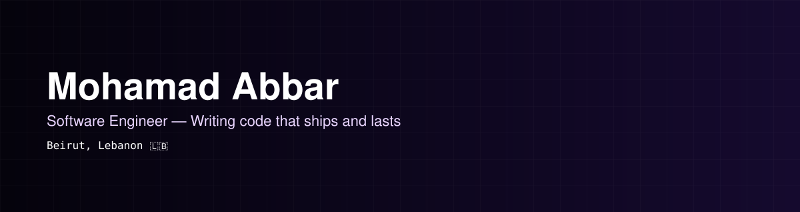
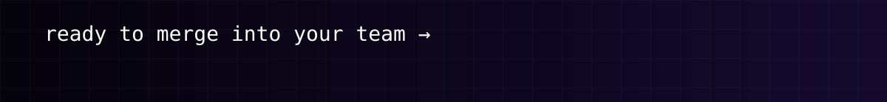

  

  
  
  

  

## 🚀 About

5 years turning hard-to-use interfaces into ones that feel obvious, based out of Beirut.

Making it work is half the job — making it feel right is the other half. That's the lens I bring to everything, from treating design systems as agreements (not just component libraries) to treating AI features as interface problems before they're model problems.

 

  

 

## 🛠️ Stack

  

Also living in this toolbox: **Zustand**, **TanStack Query**, **Zod**, **Playwright**.

 

  

 

## 🏓 Off-screen

When I'm not pushing pixels: ping pong, running, football, or basically anything outdoors.

**Fun fact:** debugs better after a run than after a coffee.

  

 

  

 

## 📊 GitHub

*The quiet graph below doesn't tell the full story — most of my commits happen under a work account, in repos you'll never see.*

  
  

  

  

  

